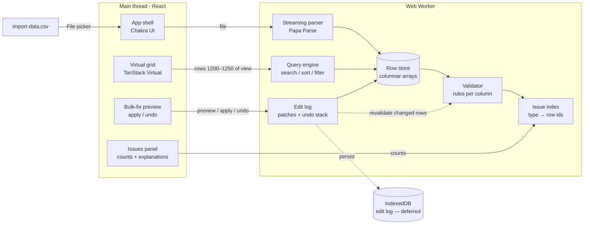

# Design Document

## 1. Architecture overview

**Core idea:** The worker owns the data, and React only renders what's on screen. Any heavy work (parse, validate, sort, filter, bulk fix) happens off the main thread, so scrolling and typing stay smooth.

## 2. Tech stack

| Concern | Choice | Why |
|---|---|---|
| Build | Vite 6 + React 19 + TypeScript | Fast dev loop, first-class worker support (`new Worker(new URL(...))`) |
| UI shell | Chakra UI | Accessible panels, dialogs and toasts without hand-written CSS |
| Grid | `@tanstack/react-virtual` | Headless and tiny; we control cell rendering for issue UX |
| CSV parsing | Papa Parse (in worker) | Streaming chunks and a byte cursor (enables resume) |
| Worker RPC | Comlink | Typed async calls to the worker instead of hand-rolled `postMessage` |
| Persistence | *Not built (D3 deferred)*: data and edits live in worker memory | Planned: IndexedDB via `idb` for the edit log, replayed after re-picking the file |

Rationale and alternatives for each choice are in [DECISIONS.md](./DECISIONS.md).

## 3. Validation rules: from configuration today, from the schema in production

In the prototype, all rules live in one file, `src/config/rules.json`, interpreted by a generic engine (`src/domain/validate.ts`). The engine knows a few check *types* (required, trimmed, pattern, oneOf with aliases, date formats, number, unique); the *rules* are data.

In production that file splits by owner:

| Part | Owner | Source |
|---|---|---|
| **Schema**: columns, required/unique, allowed values, target formats, limits | The admin or developer who sets up the importer for their system | Backend, per importer: `GET /importers/:id/schema` → same shape as `columns[]` in rules.json |
| **Reference data**: country names and aliases, currency symbols, accepted date formats | Product team, shared by all customers | A maintained library (e.g. ISO country names in many languages via `Intl.DisplayNames` or `i18n-iso-countries`), not hand-typed lists |
| **Messages**: issue titles, explanations, examples | Product team | Translation files keyed by issue code |

**End users don't edit rules.** The rules describe what the receiving system accepts, which isn't the end user's decision, and the users are non-technical. What they *can* teach the product is **mappings**: a "Remember this" option in the bulk-fix review ("always read `Holland` as `NL`"), saved per customer and applied on the next import. Confirming how dates are read ("this file is day-first") is the same kind of input. Data decisions belong to the user; rules belong to the admin.

<!-- Remaining sections (ADR, UX, performance, assumptions, AI note, trade-offs) to follow. -->
